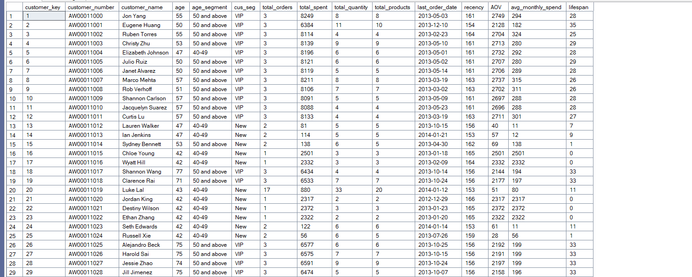
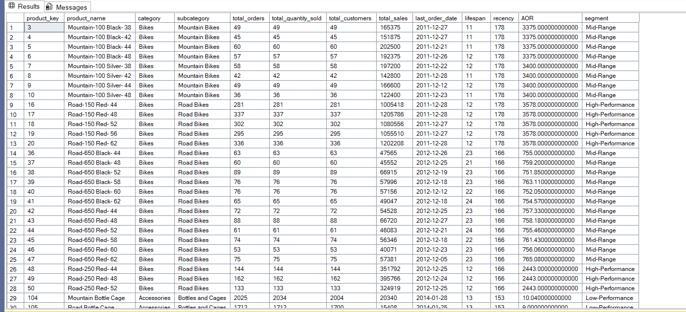

# SQL Sales Analytics

SQL Server project that analyzes sales, products, and customers. Each query answers a specific business question, from monthly trends and year-over-year growth to customer segmentation and reusable report views.

## Project Overview

The goal of this project is to turn raw sales data into answers a business can act on. Every script in the `sql_queries` folder starts with the question it solves, followed by commented code that explains the logic step by step.

**Questions this project answers:**

- How do sales, customers, and units sold change over time? Is there seasonality?
- Are we growing steadily, or just having isolated good months?
- Which products perform above or below their own average?
- Which products are growing or declining year over year?
- Which categories drive the most revenue? Are we too dependent on one?
- How are products and customers distributed across segments?

## Data Model

The analysis uses a star schema in the `gold` layer:

| Table | Type | Used for |
|---|---|---|
| `gold.fact_sales` | Fact | Orders, dates, sales amount, quantity, price |
| `gold.dim_products` | Dimension | Product name, category, subcategory, cost |
| `gold.dim_customers` | Dimension | Customer name, number, birthdate |

## Queries

| # | File | Business question | Techniques |
|---|---|---|---|
| 1 | `01_monthly_sales_trend.sql` | How do sales, customers, and quantity change month over month? | `DATETRUNC`, `GROUP BY`, `COUNT DISTINCT` |
| 2 | `02_running_total_moving_average.sql` | What is the cumulative sales and moving average price over time? | Window functions, subquery |
| 3 | `03_product_vs_average_performance.sql` | Which years are above or below each product's own average? | CTE, `AVG() OVER`, `CASE` |
| 4 | `04_product_year_over_year.sql` | How did each product's sales change versus the previous year? | CTE, `LAG()`, `CASE` |
| 5 | `05_category_contribution.sql` | Which categories contribute most to total revenue? | CTE, part-to-whole with `SUM() OVER ()` |
| 6 | `06_product_cost_segmentation.sql` | How are products spread across cost ranges? | CTE, `CASE`, data segmentation |
| 7 | `07_customer_segmentation.sql` | How many customers are VIP, Regular, or New? | CTE, `DATEDIFF`, `CASE` |
| 8 | `08_customer_report_view.sql` | One reusable report with customer metrics and segments | `CREATE VIEW`, multiple CTEs, `NULLIF` |
| 9 | `09_product_report_view.sql` | One reusable report with product metrics and performance tiers | `CREATE VIEW`, multiple CTEs, `NULLIF` |

## Segmentation Rules

**Customers** (queries 7 and 8)

| Segment | Rule |
|---|---|
| VIP | Lifespan of 12+ months and total spending over 5,000 |
| Regular | Lifespan of 12+ months and total spending of 5,000 or less |
| New | Lifespan under 12 months |

**Products** (query 9)

| Segment | Rule |
|---|---|
| High-Performance | Total sales over 300,000 |
| Mid-Range | Total sales from 25,000 to 300,000 |
| Low-Performance | Total sales under 25,000 |

## Report Views

Queries 8 and 9 create views that analysts and dashboards (such as Power BI) can query directly.

**`gold.report_customers`** includes: customer name, age and age group, customer segment, total orders, total spent, total quantity, total products, last order date, recency (months), average order value, average monthly spend, and lifespan.

**`gold.product_report`** includes: product name, category, subcategory, total orders, quantity sold, total customers, total sales, last order date, lifespan, recency (months), average order value, and performance segment.

## SQL Concepts Demonstrated

- Common Table Expressions (CTEs), including multi-step CTEs
- Window functions: `SUM() OVER`, `AVG() OVER`, `LAG()`
- Time-series analysis with `DATETRUNC`, `YEAR`, `DATEDIFF`
- Conditional logic and segmentation with `CASE`
- Joins between fact and dimension tables
- Safe division with `NULLIF`
- Creating reusable views

## Tools

- Microsoft SQL Server
- SQL Server Management Studio (SSMS)

## Author

**Shahim Al-Rhahleh**, Data Analyst
Skills: SQL, Python, Power BI, Excel

- LinkedIn: https://www.linkedin.com/in/shahim-rhahleh-7b7350288/
- Email: shhmrhahlh8@gmail.com
